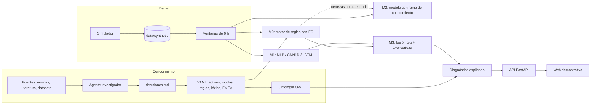
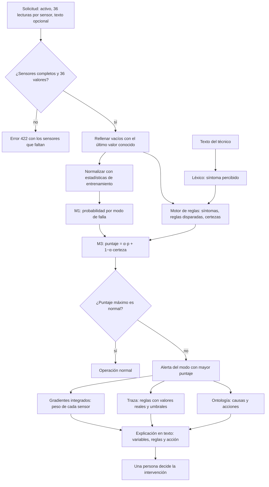
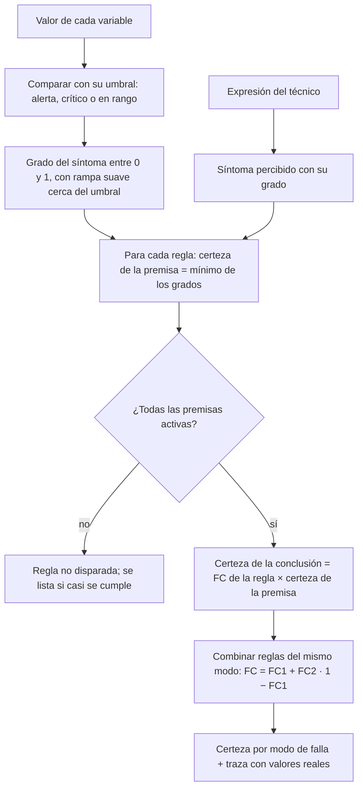
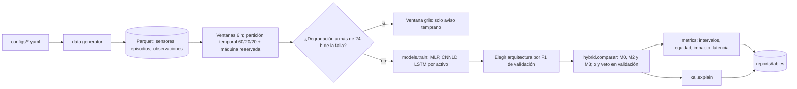
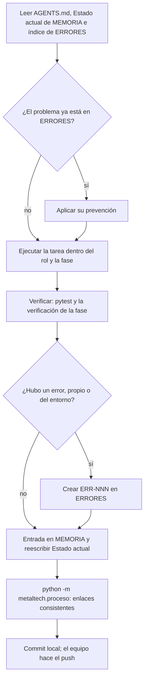
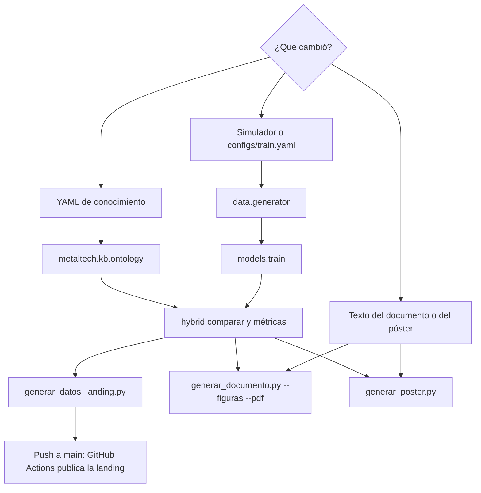
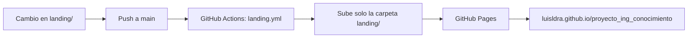

# Diagramas de flujo

Los diagramas usan Mermaid: GitHub los dibuja al abrir este archivo y VS Code los muestra con una extensión de Mermaid. Cada uno trae una explicación breve.

## 1. Flujo general del sistema

De los datos al diagnóstico explicado. El conocimiento experto y el modelo trabajan en paralelo y se combinan al final (M3).

## 2. Un diagnóstico, de la ventana a la explicación

Lo que pasa cuando la web o un programa llama a `POST /diagnose`.

## 3. Motor de reglas con factores de certeza

Cómo se calcula la certeza de cada modo de falla (MYCIN).

## 4. Generación de datos y entrenamiento

El camino que siguen los comandos de la [puesta en marcha](puesta_en_marcha.md#4-regenerar-datos-modelos-y-reportes).

## 5. Trabajo de los agentes

El protocolo de [AGENTS.md](../../AGENTS.md), sección 6.

## 6. De un cambio a los entregables

Qué regenerar según lo que cambió.

## 7. Publicación de la landing

`landing.yml` es el único flujo de publicación. No use las plantillas que sugiere GitHub Pages: publican todo el repositorio ([ERR-030](../agentes/ERRORES.md)).
