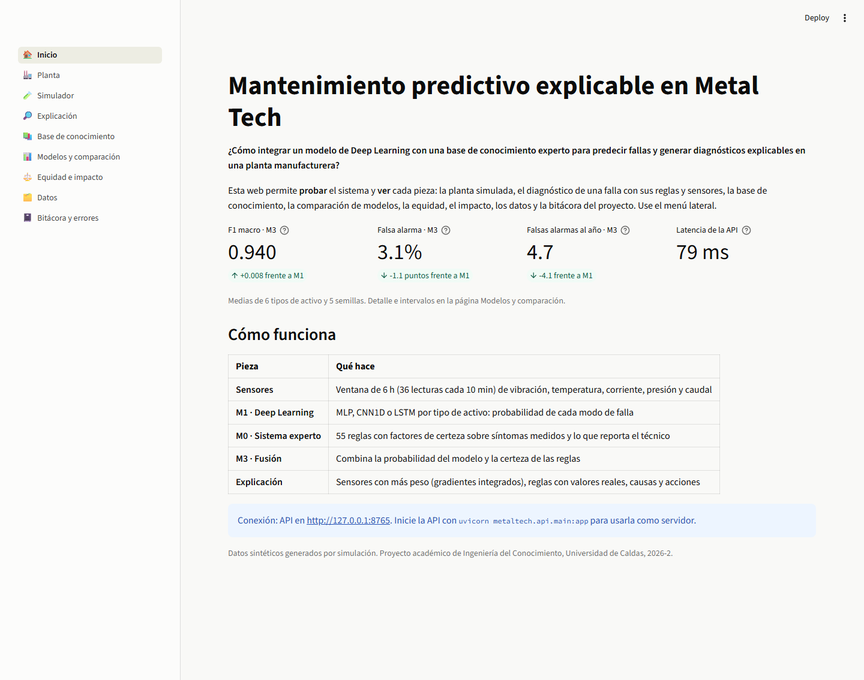
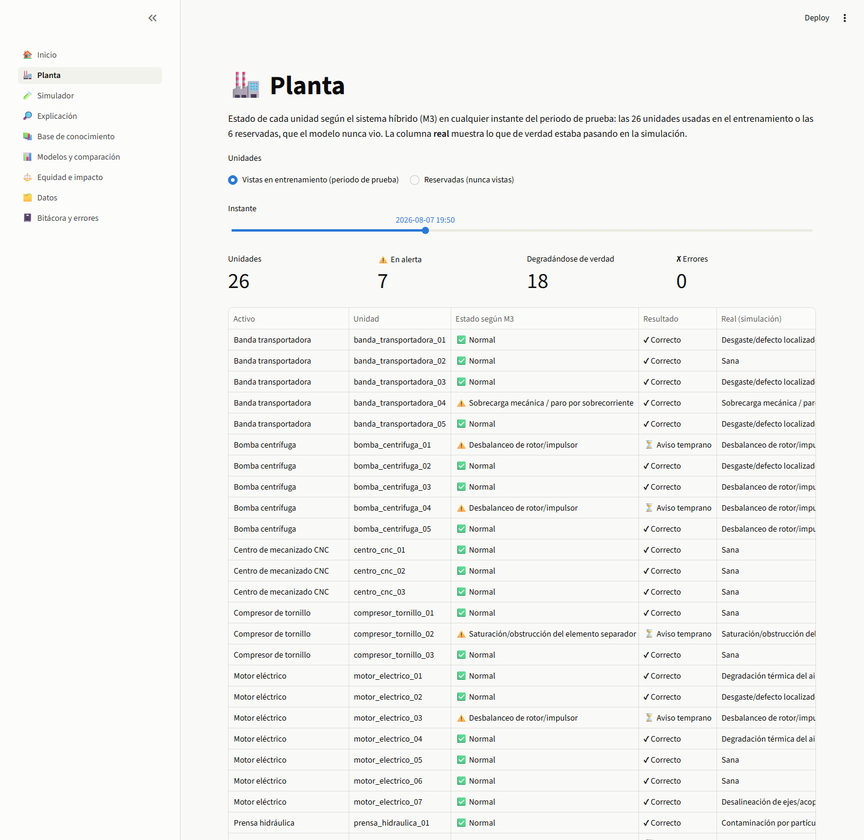
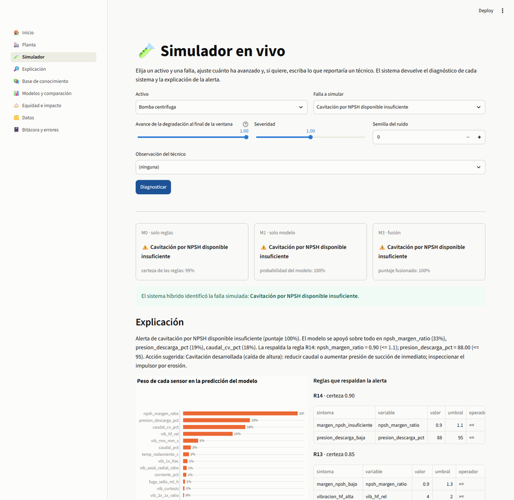
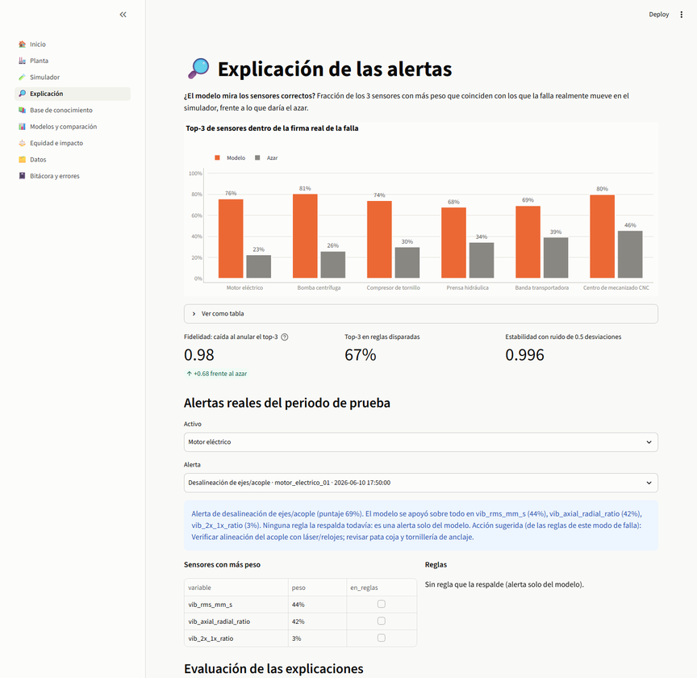
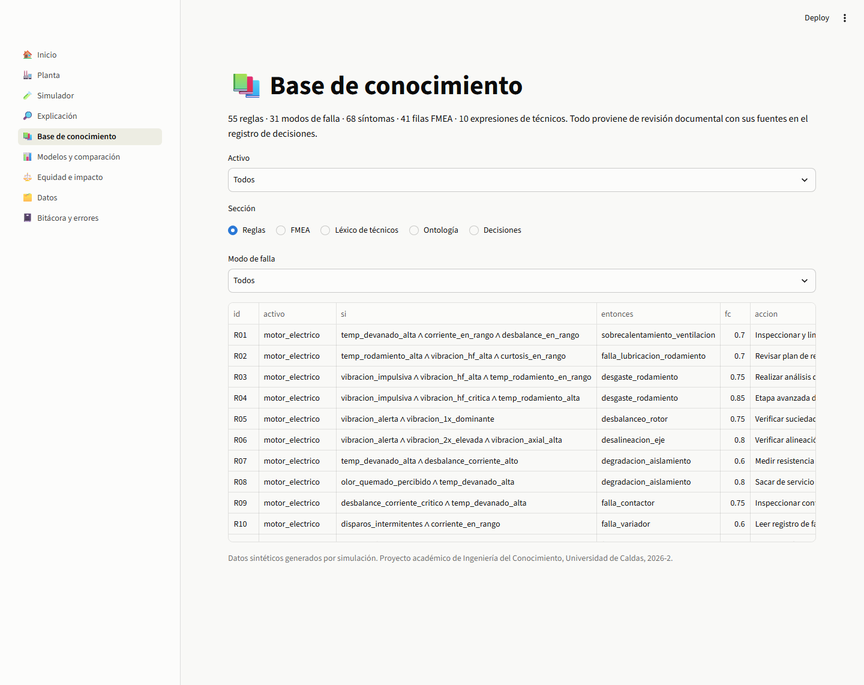
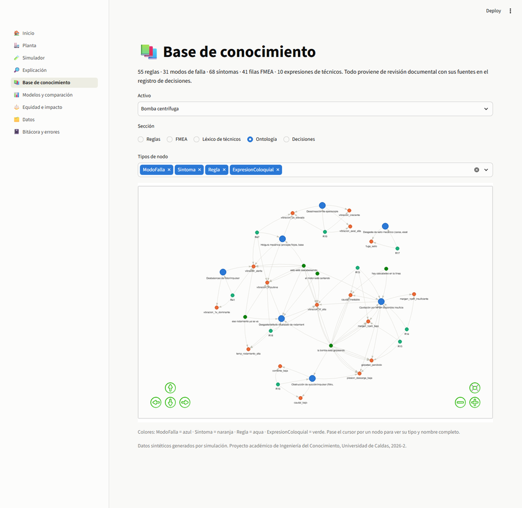
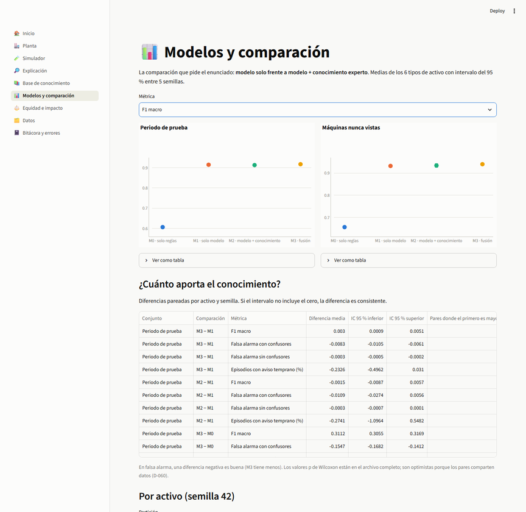
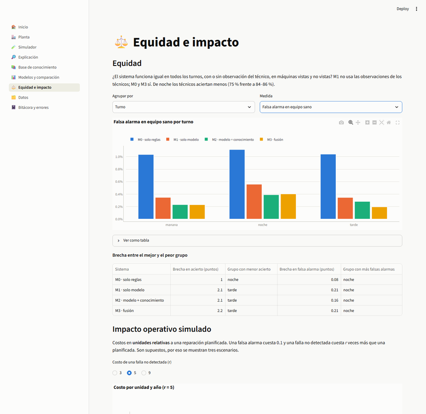
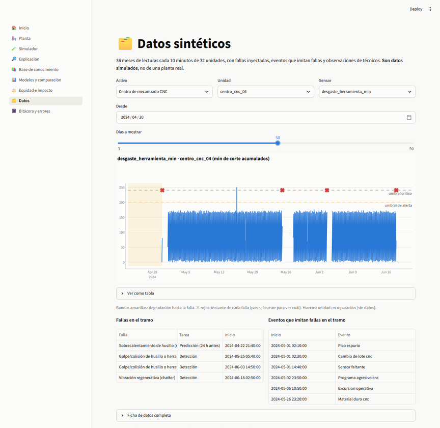
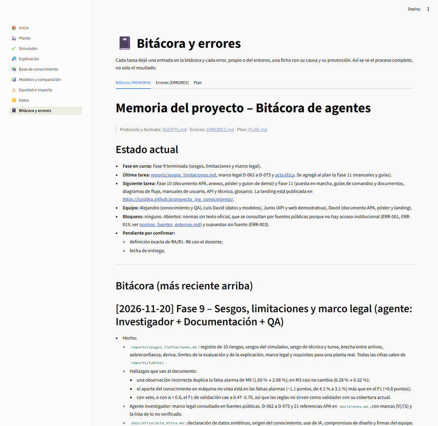

# Manual de usuario de la web demostrativa

La web permite **probar** el sistema y **ver** todo lo que tiene por dentro: la base de conocimiento, los modelos, las explicaciones, las métricas y el proceso. Está pensada para el docente, los evaluadores y el público de la demo; no hace falta saber programar.

> Los datos son **sintéticos** y el sistema es un prototipo: **recomienda**, y una persona decide.

## Cómo abrirla

Con el proyecto instalado (ver [puesta en marcha](puesta_en_marcha.md)):

```bash
streamlit run src/metaltech/dashboard/app.py
```

Se abre en http://localhost:8501. El menú de la izquierda lleva a las 8 páginas. Debajo de cada gráfico hay un botón **Ver como tabla** con los mismos datos en números.

**Colores fijos de los sistemas:** M0 (solo reglas) azul, M1 (solo modelo) naranja, M2 (modelo + conocimiento) verde y M3 (fusión) amarillo. El estado de los equipos usa verde (normal), amarillo (alerta) y rojo (crítico), siempre con un ícono y un texto.

## Recorrido guiado de 3 minutos: una cavitación en la bomba

1. Abra **Simulador**.
2. En *Activo* elija **Bomba centrífuga**; en *Falla a simular*, **Cavitación por NPSH disponible insuficiente**.
3. Deje *Avance* y *Severidad* en 1.00 y pulse **Diagnosticar**.
4. Las tres tarjetas muestran el diagnóstico de M0, M1 y M3: los tres identifican la cavitación.
5. En **Explicación**, el gráfico de barras dice qué sensores pesaron más en el modelo (el margen de NPSH), y las tablas de la derecha muestran las reglas R14 y R13 con el **valor real** de cada variable frente a su umbral.
6. Lea las **acciones sugeridas** y las **causas posibles**.
7. Baje a **Ventana de sensores simulada**: el margen de NPSH cae bajo la línea de alerta y la vibración de alta frecuencia sube.
8. Vuelva arriba, elija *Falla a simular* = **operación normal** y diagnostique de nuevo: ningún sistema da alerta.

## Páginas

### Inicio



La pregunta del proyecto y cuatro cifras de M3: F1 macro, falsa alarma, falsas alarmas al año (cada una comparada con M1) y latencia de la API. Debajo, una tabla de **cómo funciona** cada pieza y el estado de la conexión con la API. Es el punto de partida de la demo.

### 1. Planta



El estado de cada unidad en un instante del periodo de prueba, según M3.

- **Unidades:** *Vistas en entrenamiento* (periodo de prueba) o *Reservadas*, las máquinas que el modelo nunca vio.
- **Instante:** mueva el control para recorrer el tiempo y ver cómo aparecen y desaparecen las alertas.
- Arriba, el resumen: unidades, cuántas están en alerta, cuántas se degradan de verdad y cuántos errores hay.
- La tabla compara, por unidad, el **estado según M3** con lo que **realmente** pasaba en la simulación. La columna *Resultado* dice si el diagnóstico es correcto, si es un aviso temprano (la falla aún está lejos) o un error.

### 2. Simulador



Inyecta una falla en una ventana de 6 horas y muestra el diagnóstico paso a paso.

| Control | Qué hace |
|---|---|
| Activo | Tipo de equipo |
| Falla a simular | Modo de falla del activo, u *operación normal* |
| Avance de la degradación | Qué tan cerca de la falla termina la ventana (1.00 = en el momento de la falla) |
| Severidad | Multiplica el cambio de la firma (1.00 = típica) |
| Semilla del ruido | Cambia el ruido aleatorio para ver otra versión del mismo caso |
| Observación del técnico | Una frase del léxico ("el motor está cantando"…), *(ninguna)* o *Escribir otra…* para texto libre |
| Diagnosticar | Ejecuta los cuatro pasos: sensores → reglas → modelo → fusión |

Resultado:
- **Tarjetas M0, M1 y M3:** modo detectado con la certeza de las reglas, la probabilidad del modelo y el puntaje fusionado.
- **Explicación:** texto, peso de cada sensor, reglas que respaldan la alerta con valores reales, acciones y causas.
- **Reglas que casi se cumplen:** reglas a las que les falta una premisa; útil para entender por qué una falla no se confirmó.
- **Ventana de sensores simulada:** elija los *Sensores* a graficar; las líneas punteadas son los umbrales de alerta y crítico.

**Cómo interpretar:** si el modelo da una alerta y **ninguna regla la respalda**, el texto lo dice. Esa alerta merece más verificación antes de intervenir.

### 3. Explicación



- **Métricas de explicabilidad** por activo: si los sensores con más peso coinciden con la firma real de la falla y con las reglas, la caída de probabilidad al anularlos (fidelidad) y la estabilidad ante ruido.
- **Alertas reales del periodo de prueba:** elija *Activo* y *Alerta* para leer la explicación completa de una alerta real.
- **Evaluación de las explicaciones:** resultados del panel de agentes, que comparó la explicación del modelo solo con la híbrida. Es una validación exploratoria, no una evaluación con personas.

### 4. Base de conocimiento



Elija el *Activo* (o *Todos*) y la *Sección*:

| Sección | Muestra |
|---|---|
| Reglas | Cada regla con sus premisas, conclusión, FC, acción y fuentes; filtrable por *Modo de falla* |
| FMEA | Por modo de falla: componente, síntomas, causas, acciones, severidad, ocurrencia, detección y NPR |
| Léxico de técnicos | Expresiones coloquiales, el síntoma que representan y los modos candidatos; *Física de cada expresión* explica el porqué |
| Ontología | Grafo interactivo de la ontología (filtre con *Tipos de nodo*; arrastre y haga zoom) |
| Decisiones | Las decisiones documentadas del agente investigador, con su confianza |



### 5. Modelos y comparación



Compara M0, M1, M2 y M3 con intervalos de confianza entre 5 semillas.

- **Métrica:** F1 macro, precisión, recall, falsa alarma (con y sin confusores), aviso temprano, etc.
- **¿Cuánto aporta el conocimiento?:** diferencias pareadas M3 − M1 y M2 − M1.
- **Por activo (semilla 42):** elija la *Partición* (periodo de prueba o máquinas nunca vistas) para ver el resultado de cada sistema en cada tipo de activo.

### 6. Equidad e impacto



- **Equidad:** elija *Agrupar por* (turno, observación del técnico, máquina vista o no, activo) y la *Medida* (acierto en fallas o falsa alarma en equipo sano). La tabla de **brecha** muestra la diferencia entre el mejor y el peor grupo.
- **Impacto operativo simulado:** costo por unidad y año en unidades de una reparación planificada. Elija *r*, cuántas veces más cuesta una falla no detectada (3, 5 o 9). Son supuestos, por eso hay tres escenarios.

### 7. Datos



Explorador del dataset sintético: elija *Activo*, *Unidad*, *Sensor*, la fecha *Desde* y los *Días a mostrar*.

- Las bandas amarillas marcan la degradación hasta la falla, las ✕ rojas el instante de cada falla y los huecos, la unidad en reparación. Las líneas punteadas son los umbrales de alerta y crítico.
- Debajo hay dos tablas: las **fallas** del tramo (con su tarea: predicción o detección) y los **eventos que imitan fallas** (picos, cambios de lote, sensores faltantes…).
- *Ficha de datos completa* explica cada columna y los supuestos del simulador.

### 8. Bitácora y errores



El proceso del proyecto tal como lo registraron los agentes: pestañas **Bitácora (MEMORIA)**, **Errores (ERRORES)** y **Plan**.

## Si algo falla

| Situación | Qué hacer |
|---|---|
| Aviso de que la API no responde | La web sigue funcionando con la API interna; espere unos segundos y recargue |
| Página con el mensaje de que faltan datos o reportes | Hay que regenerarlos (ver [puesta en marcha](puesta_en_marcha.md#4-regenerar-datos-modelos-y-reportes)) |
| El grafo de la ontología no aparece | Recargue la página; requiere JavaScript habilitado |
| Streamlit no se cierra con Ctrl+C (Windows) | Cierre la terminal ([ERR-027](../agentes/ERRORES.md)) |
